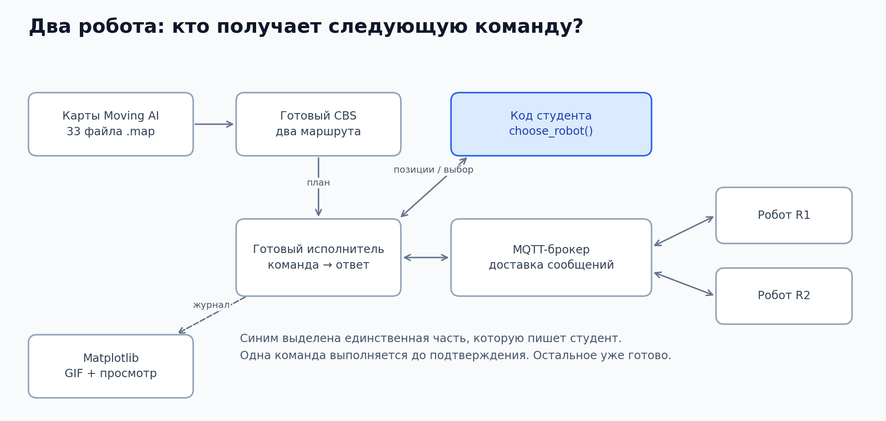
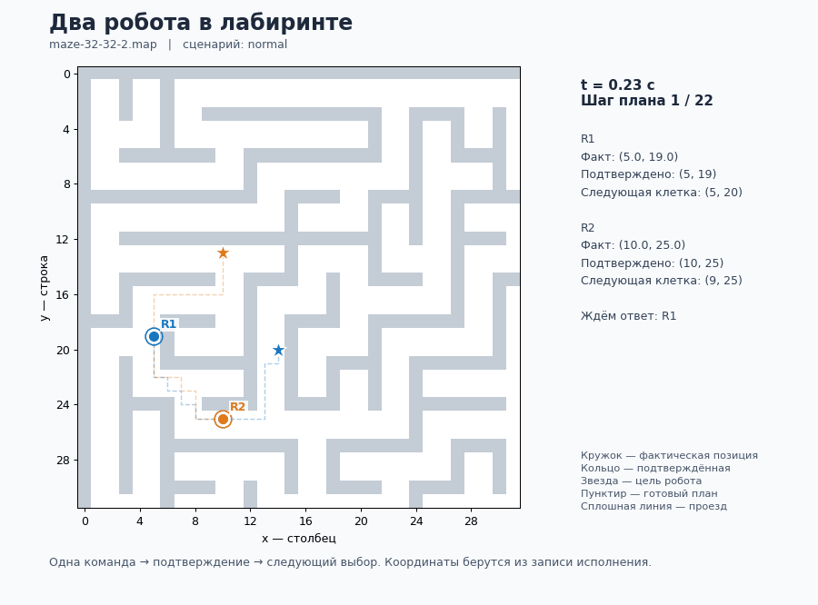

# Практика 1. Два робота в лабиринте

**Курс: Архитектура наземной инфраструктуры БпТС.**

Напишите функцию `choose_robot`, которая выбирает, какой робот может сделать следующий шаг, не въезжая в занятую клетку. Оба робота должны добраться до своих целей.

Карта, планировщик CBS, имитаторы роботов, MQTT-брокер и визуализация уже готовы. Изменять нужно только [`dispatcher.py`](dispatcher.py).

## Какой вариант выполнять

**Вариант — это карта и заданные для двух роботов старты и цели.** Одну карту можно использовать в нескольких вариантах.

Сейчас подготовлены **три варианта на одном лабиринте** `maze-32-32-2.map`. Номер назначает преподаватель. Если номер не назначен, используйте вариант 1.

| Вариант | Имя для запуска (`--case`) | R1: старт → цель | R2: старт → цель |
| --- | --- | --- | --- |
| 1 | `crossing` | `(5, 19)` → `(14, 20)` | `(8, 22)` → `(14, 11)` |
| 2 | `crossing2` | `(5, 19)` → `(14, 20)` | `(10, 25)` → `(10, 13)` |
| 3 | `crossing3` | `(5, 19)` → `(14, 20)` | `(13, 20)` → `(1, 10)` |

Координаты имеют вид `(x, y)`: `x` растёт вправо, `y` — вниз от левого верхнего угла карты. Настройки уже записаны в [`data/cases.json`](data/cases.json); программа загрузит их по имени варианта.

В папке [`maps/`](maps/) сохранены **33 карты**, но это запас карт для подготовки заданий, а не 33 готовых варианта. Для выполнения этой практики выбирать файл карты или менять координаты вручную не требуется.

## Схема системы



Планировщик передаёт маршруты готовому исполнителю. Исполнитель вызывает вашу функцию с текущими подтверждёнными позициями и следующими клетками, отправляет выбранному роботу команду через MQTT и получает подтверждение выполнения.

Брокер доставляет сообщения. Решение, кого выпускать, принимает ваша функция. Matplotlib показывает запись фактического исполнения.

## Запуск

Нужен Python 3.10 или новее. Комплект проверен на Windows с Python 3.13. Все команды ниже выполняйте в терминале из папки `practices/01-maze-dispatcher`.

**В примерах выбран вариант 2 (`crossing2`).** Для своего варианта замените `crossing2` на имя из таблицы, в том числе в командах просмотра журнала.

### Windows

Один раз запустите `setup.cmd` двойным щелчком или из PowerShell:

```powershell
.\setup.cmd
```

После установки используйте команды PowerShell:

```powershell
.\.venv\Scripts\python.exe check.py
.\.venv\Scripts\python.exe run.py --case crossing2
.\.venv\Scripts\python.exe run.py --case crossing2 --fault slow
```

`start-student.cmd` запускает вариант 1. Для назначенного вам варианта используйте команды с `--case` выше.

### Linux и macOS

Один раз создайте окружение и установите зависимости:

```sh
python3 -m venv .venv
. .venv/bin/activate
python -m pip install -r requirements.txt
```

Проверьте функцию и запустите выбранный вариант:

```sh
python check.py
python run.py --case crossing2
python run.py --case crossing2 --fault slow
```

При каждом открытии нового терминала перейдите в папку практики и снова выполните `. .venv/bin/activate`. Файлы `.cmd` используются только на Windows.

### Что должно произойти

Пока заготовка `dispatcher.py` возвращает `None`, роботы стоят. Через две секунды ожидания стенд завершает опыт и формирует визуализацию с причиной остановки. До выполнения задания часть проверок `check.py` тоже будет завершаться с `FAIL`.

После правильного заполнения функции `check.py` выводит `Пройдено 4 из 4`, а при проезде оба робота достигают целей и в терминале появляется `"success": true`.

Для интерактивного окна нужен графический backend matplotlib, например Tk. На машине без графического окружения добавьте `--no-show` к команде запуска: GIF, PNG и журнал сохранятся без открытия окна. Например, на Linux/macOS: `python run.py --case crossing2 --no-show`.

## Что написать

Функция принимает два словаря:

```python
positions = {"R1": (0, 0), "R2": (1, 0)}
targets = {"R1": (1, 0), "R2": (2, 0)}
```

- `positions` — последние подтверждённые клетки роботов.
- `targets` — следующие клетки текущего шага готового плана.
- Координаты записаны как `(x, y)`, начало находится в левом верхнем углу карты.

Верните `"R1"`, `"R2"` или `None`, если двигаться сейчас некому.

В приведённом примере нужно выбрать R2: R1 хочет занять его клетку. После подтверждения ухода R2 функция будет вызвана снова, и можно выбрать R1.

Два правила выбора:

1. Если следующая клетка совпадает с текущей позицией робота, пропустите его.
2. Если следующая клетка занята другим роботом, тоже пропустите его.

Первого робота, прошедшего обе проверки, можно выпускать. Если подходят оба, можно выбрать любого. Если никто не подходит, верните `None`.

## Порядок выполнения

1. Вручную решите первые два примера из [`check.py`](check.py).
2. Допишите `choose_robot` и проверьте четыре примера командой `check.py`.
3. Запустите **свой вариант** сначала в обычном режиме, затем с `--fault slow`, используя команды выше. В обоих запусках укажите одно и то же имя `--case`. В медленном режиме каждый переход R2 занимает в восемь раз больше времени.
4. На анимации найдите момент ожидания. Назовите занятую клетку и объясните, почему сначала должен двигаться другой робот.

## Что сдавать

- Файл `dispatcher.py`.
- Один GIF успешного проезда.
- Номер варианта и короткое объяснение одного решения по координатам на выбранном кадре.

## Визуализация и отладка

После запуска в `output/` автоматически сохраняются GIF, PNG и JSON-журнал. Затем открывается окно matplotlib с ползунком **Кадр** и кнопкой **Пуск / Пауза**.



- Синий робот — R1, оранжевый — R2; звёзды обозначают цели.
- Закрашенный кружок показывает фактическое положение в модели.
- Кольцо показывает последнюю подтверждённую клетку.
- Пунктир обозначает готовый план, сплошная линия — выполненный проезд.
- Справа показаны координаты, следующая клетка и ожидание ответа.

Имена результатов содержат вариант и режим. Например, обычный запуск варианта 2 создаёт `output/student_crossing2_normal.gif`, `.png` и `.json`. Медленный запуск создаёт файлы `student_crossing2_slow.*`.

При ошибке сохраняется запись до момента остановки с её причиной. Для повторного просмотра журнала варианта 2 на Linux/macOS:

```sh
python visualize.py output/student_crossing2_normal.json
```

На Windows:

```powershell
.\.venv\Scripts\python.exe visualize.py output/student_crossing2_normal.json
```

## Преподавателю: набор карт и подготовка новых вариантов

В [`maps/`](maps/) находятся все **33 карты** официального набора [Moving AI MAPF](https://www.movingai.com/benchmarks/mapf/index.html). Файлы сохранены без изменений; размеры перечислены в [`CATALOG.txt`](maps/CATALOG.txt), источник и контрольные суммы — в [`SOURCES.json`](maps/SOURCES.json).

Варианты 1–3 из таблицы используют карту `maze-32-32-2.map`. Старты и цели взяты из исходного сценария Moving AI: строки 2/40, 2/54 и 2/62 без заголовка соответственно.

Для нового варианта нужно добавить запись в [`data/cases.json`](data/cases.json) с именем карты, стартами и целями двух роботов, проверить совместный проезд и добавить вариант в таблицу задания. Одного файла `.map` недостаточно: он задаёт только расположение стен и проходов.

Для первых экспериментов используйте карты 32 × 32. Планировщик ограничен пятью секундами поиска и горизонтом 256 шагов; большие карты могут не уложиться в эти лимиты.

В учебной сетке разрешены четыре направления движения; символы `.` и `G` проходимы, остальные считаются препятствиями.

## Источники

- [Moving AI MAPF](https://www.movingai.com/benchmarks/mapf/index.html) — карты и сценарии.
- [Формат Moving AI](https://www.movingai.com/benchmarks/formats.html).
- [CBS и A* — Ashwin Bose](https://github.com/atb033/multi_agent_path_planning), версия `89f69e11944b172e11c3bcbbecc57344eaa4be9c`. Исходники в `vendor/cbs/` сохранены без изменений, [лицензия MIT](vendor/LICENSE.txt).

Обёртка `planner.py` добавляет ограничения поиска, проверку пребывания в конечной клетке, расстояния до цели для ускорения A* и проверку результата. Учебный формат сообщений не является реализацией VDA 5050.
