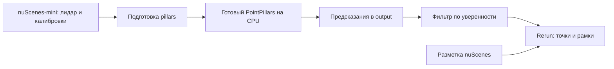

# Практика 2. PointPillars на лидарных данных

**Курс: Архитектура наземной инфраструктуры БпТС.**

Запустите готовый детектор PointPillars на пяти кадрах своей сцены nuScenes-mini. Посмотрите результат в Rerun и объясните, как порог уверенности влияет на обнаружения.

Модель уже обучена. Для задания достаточно запускать готовые скрипты и менять номер варианта и порог. GPU не требуется: обработка выполняется на CPU.

## Что делает программа

Лидар измеряет точки на поверхностях окружающих объектов. PointPillars группирует эти точки в вертикальные столбцы — *pillars* — и предсказывает рамки объектов. У каждого обнаружения есть класс, положение, размеры, направление и оценка уверенности от 0 до 1.



`run.py` запускает модель и сохраняет предсказания. `view.py` читает сохранённые результаты и создаёт запись Rerun. Изменение порога в `view.py` **не запускает сеть повторно**.

## 1. Установка

Используйте **Python 3.13, 64 bit**. Команды выполняйте из папки `practices/02-pointpillars`. Для этой практики создайте отдельное окружение; окружение практики 1 использовать не нужно.

Потребуется интернет для установки библиотек, загрузки nuScenes-mini (около 4 ГБ) и весов. Заранее освободите не менее 10 ГБ на диске. Для просмотра используйте настольный Rerun из установленного окружения.

### Windows: PowerShell или командная строка

```powershell
py -3.13 -m venv .venv
.\.venv\Scripts\python.exe -m pip install torch==2.10.0 --index-url https://download.pytorch.org/whl/cpu
.\.venv\Scripts\python.exe -m pip install -r requirements.txt
```

Во всех дальнейших примерах заменяйте `python` на `.\.venv\Scripts\python.exe`.

### Linux

```sh
python3.13 -m venv .venv
. .venv/bin/activate
python -m pip install torch==2.10.0 --index-url https://download.pytorch.org/whl/cpu
python -m pip install -r requirements.txt
```

### macOS с Apple Silicon

```sh
python3.13 -m venv .venv
. .venv/bin/activate
python -m pip install torch==2.10.0
python -m pip install -r requirements.txt
```

На Linux и macOS при открытии нового терминала снова активируйте окружение. Если установка завершилась ошибкой, исправьте её до перехода к запуску. Проверенная система — Windows; команды Linux и macOS приведены отдельно, но на этих ОС работа пока не проверялась.

## 2. Подготовка данных

Один раз выполните:

```sh
python download_data.py
```

Скрипт скачает официальный архив и извлечёт только лидарные сканы и метаданные. Изображения камер для этой работы не нужны. Архив можно передать между своими компьютерами и использовать без повторной загрузки:

```sh
python download_data.py --archive "D:/datasets/v1.0-mini.tgz"
```

После извлечения должны появиться:

```text
data/
├── v1.0-mini/           # JSON: сцены, разметка и калибровки
├── samples/LIDAR_TOP/   # ключевые лидарные сканы
└── sweeps/LIDAR_TOP/    # предыдущие сканы для входа модели
```

Если данные уже распакованы в другом месте, укажите их папку: `python run.py --variant 1 --data "D:/datasets/nuscenes"`.

## 3. Выполнение своего варианта

Номер назначает преподаватель. В mini всего **10 сцен**; 33 варианта отличаются сценой и набором из пяти последовательных ключевых кадров. Нумерация кадров внутри сцены начинается с **1**. Состав вариантов хранится в [`variants.json`](variants.json).

| Вариант | Сцена | Кадры |
| --- | --- | --- |
| 1 | `scene-0061` | 1–5 |
| 2 | `scene-0103` | 1–5 |
| 3 | `scene-0553` | 1–5 |
| 4 | `scene-0655` | 1–5 |
| 5 | `scene-0757` | 1–5 |
| 6 | `scene-0796` | 1–5 |
| 7 | `scene-0916` | 1–5 |
| 8 | `scene-1077` | 1–5 |
| 9 | `scene-1094` | 1–5 |
| 10 | `scene-1100` | 1–5 |
| 11 | `scene-0061` | 11–15 |
| 12 | `scene-0103` | 11–15 |
| 13 | `scene-0553` | 11–15 |
| 14 | `scene-0655` | 11–15 |
| 15 | `scene-0757` | 11–15 |
| 16 | `scene-0796` | 11–15 |
| 17 | `scene-0916` | 11–15 |
| 18 | `scene-1077` | 11–15 |
| 19 | `scene-1094` | 11–15 |
| 20 | `scene-1100` | 11–15 |
| 21 | `scene-0061` | 21–25 |
| 22 | `scene-0103` | 21–25 |
| 23 | `scene-0553` | 21–25 |
| 24 | `scene-0655` | 21–25 |
| 25 | `scene-0757` | 21–25 |
| 26 | `scene-0796` | 21–25 |
| 27 | `scene-0916` | 21–25 |
| 28 | `scene-1077` | 21–25 |
| 29 | `scene-1094` | 21–25 |
| 30 | `scene-1100` | 21–25 |
| 31 | `scene-0061` | 31–35 |
| 32 | `scene-0103` | 31–35 |
| 33 | `scene-0553` | 31–35 |

Например, для варианта 17:

```sh
python run.py --variant 17
```

Первый запуск скачивает веса. Затем программа последовательно обрабатывает пять кадров. Для каждого кадра выводятся количество обнаружений и затраченное время. В конце появляется сообщение `Готово. Просмотр: python view.py --variant 17`.

Результаты сохраняются в `output/variant_17/`: `result.json` содержит сведения о запуске, файлы `.npz` — точки, разметку и предсказания по кадрам. Повторный запуск `run.py` для того же варианта пересчитает и перезапишет эти результаты.

## 4. Просмотр в Rerun

```sh
python view.py --variant 17 --score 0.5
```

Откроется Rerun с записью вашей сцены:

- серые точки — текущий лидарный скан;
- оранжевые рамки — обнаружения PointPillars;
- зелёные рамки — разметка датасета;
- временная шкала `frame` — номер кадра внутри сцены.

На нижней временной шкале выберите `frame`. Вращайте сцену мышью, приближайте объекты колёсиком и выбирайте кадры на временной шкале. В дереве сущностей можно отдельно скрыть `ground_truth` или `predictions`. Подписи обнаружений содержат класс и уверенность; по умолчанию постоянное отображение подписей отключено, чтобы не закрывать облако точек.

Все рамки и точки приведены к системе координат **текущего лидара**, расстояния измеряются в метрах. Начало координат движется вместе с автомобилем. Это покадровая детекция: рамки не имеют постоянных идентификаторов объектов между кадрами.

Теперь сравните три порога:

```sh
python view.py --variant 17 --score 0.2
python view.py --variant 17 --score 0.5
python view.py --variant 17 --score 0.8
```

Закрывайте окно Rerun, чтобы выполнить следующую команду в том же терминале. Порог `0.8` оставляет только обнаружения с оценкой не ниже `0.8`; это **не гарантия правильности** обнаружения. Высокий порог может убрать как ложные, так и правильные рамки.

Для каждого порога сохраняется отдельная запись, например `output/variant_17/score_0.5.rrd`. Её можно открыть через **File → Open** в Rerun, даже без исходного датасета и весов. Для сохранения без открытия окна добавьте `--save-only`.

## 5. Что исследовать и сдать

1. Выберите один из пяти кадров. Сравните **этот же кадр** при порогах `0.2`, `0.5`, `0.8`.
2. Запишите число обнаружений при каждом пороге — `view.py` выводит его в терминале.
3. Покажите один пример, где предсказание согласуется с разметкой, и один пример расхождения. Если на выбранном кадре расхождения не видны, проверьте остальные четыре и укажите результат наблюдения.
4. Объясните, какую рамку убрал повышенный порог: полезное обнаружение или вероятную ошибку.
5. Представьте, что результат нужен серверу наземной инфраструктуры. Что вы передадите по сети: исходное облако точек или список обнаруженных объектов? Назовите преимущество и ограничение выбранного варианта.

Сдайте номер варианта, одну запись `.rrd`, три скриншота одного кадра при разных порогах и короткую таблицу:

| Порог | Число обнаружений | Что изменилось |
| --- | --- | --- |
| 0.2 | … | … |
| 0.5 | … | … |
| 0.8 | … | … |

## Где находится код

| Файл | Назначение |
| --- | --- |
| [`run.py`](run.py) | Последовательность обработки пяти кадров |
| [`view.py`](view.py) | Фильтрация предсказаний и запись Rerun |
| [`detector.py`](detector.py) | Готовая сеть, подготовка pillars на CPU, удаление дублей |
| [`dataset.py`](dataset.py) | Чтение nuScenes и преобразование разметки в координаты лидара |
| [`download_data.py`](download_data.py) | Загрузка и извлечение датасета |

Для понимания запуска начните с `run.py`. Самый простой фрагмент для изучения в `view.py`: `keep = data["scores"] >= args.score` — выбор обнаружений по порогу.

## Особенности этой учебной работы

- Используется готовый **PointPillars MultiHead для 10 классов nuScenes** из `torch-pointcloud`, с весами, перенесёнными из OpenPCDet. Архитектура сети и веса взяты из библиотеки; подготовка pillars написана на NumPy, чтобы обойти сборку `spconv` и CUDA.
- Вход содержит текущий и до девяти предыдущих сканов, приведённых к текущему лидару с учётом движения автомобиля. На самом первом кадре истории может быть меньше. В Rerun для ясности отображается только текущий скан.
- В зелёной разметке показаны поддерживаемые 10 классов, с хотя бы одной лидарной точкой и центром в горизонтальной области модели. Низкие оценки отсекаются при сохранении на уровне `0.1`; допустимые пороги просмотра — от `0.1` до `1`.
- Для удаления дублей используется CPU-постобработка из примера библиотеки: NMS отдельно по классам, порог IoU `0.2`, axis-aligned 3D IoU. Работа предназначена для наблюдения результатов, а не воспроизведения официального рейтинга nuScenes.
- Часть mini относится к обучающей выборке исходной модели. Наблюдения на этих сценах не являются независимой оценкой её качества. Обучение и вычисление mAP/NDS в задание не входят.

## Проверка готовности

Проверено на Windows, Python 3.13, PyTorch 2.10.0 CPU и Intel Core Ultra 7 155U: полностью обработаны варианты 1 и 33, дополнительно — по кадру из остальных восьми сцен. На этом компьютере один кадр занимал примерно 3–4 секунды без учёта первоначальной загрузки библиотек и весов; на другом компьютере время может отличаться.

Все 33 диапазона кадров проверены по метаданным. Записи Rerun для трёх порогов прошли `rerun rrd verify`; также проверены подготовка pillars и преобразование координат. Эти небольшие проверки можно повторить командой `python -m unittest discover -s tests -v` — датасет и веса для них не нужны. Взаимное расположение точек и рамок дополнительно проверено на виде сверху.

## Источники

- [nuScenes](https://www.nuscenes.org/nuscenes) — датасет и условия использования; данные загружаются с официального сайта и не включены в Git.
- [Официальный список mini-сцен](https://github.com/nutonomy/nuscenes-devkit/blob/master/python-sdk/nuscenes/utils/splits.py).
- [PointPillars: статья](https://arxiv.org/abs/1812.05784).
- [OpenPCDet](https://github.com/open-mmlab/OpenPCDet) — исходная реализация модели.
- [torch-pointcloud](https://github.com/arthurdjn/pytorch-pointcloud) — используемая библиотека, Apache-2.0; версия закреплена в `requirements.txt`.
- [Веса nuScenes](https://huggingface.co/torch-pointcloud/pointpillars-multihead.nuscenes.openpcdet/tree/4de6b68e356558a9155b7452736d4641f198d7f6) — зафиксированная ревизия, формат Safetensors.
- [Rerun](https://rerun.io/docs/getting-started) — просмотр и сохранение пространственных данных.
